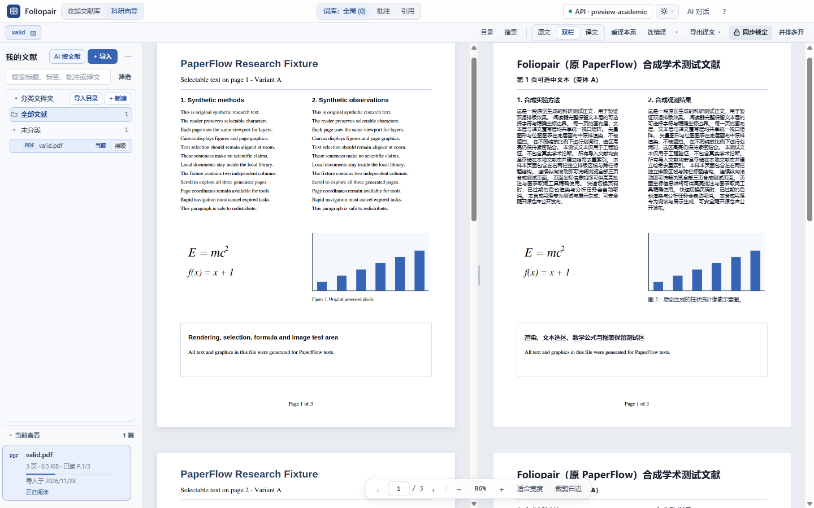

# Foliopair

**原名 PaperFlow · 面向科研论文的本地安全隔离双语 PDF 阅读器 · `AGPL-3.0-only` · `Windows x64 / Linux x64`**

Foliopair（原 PaperFlow）基于 **Electron 44 + React 19 + TypeScript + PDF.js 6.4 + SQLite（better-sqlite3）** 构建，聚焦「**本地优先、版面保真、安全隔离、兼容主流学术工作流**」的论文精读体验（为保障历史版本平滑升级，底层仍兼容沿用 `PaperFlow` 数据目录、`paperflow.sqlite`、`paperflow-backup.json` 与 `window.paperflow` 桥接契约）：

- 文献库存储、多级学科分类整理、PDF 版面解析、自动大纲、图表裁剪速览、引用提取与便携备份全部运行在**本地且不依赖大模型**；
- 双语翻译、划句 AI 伴读、AI 论文对话、学术技能与摘要速览通过 Electron 主进程受控代理接入 **OpenAI 兼容 API**（DeepSeek / OpenAI / 本机 Ollama 等）或 **本机 AI CLI**（Codex CLI / Gemini CLI / 自定义 CLI），译文与对话记录持久化缓存于本地 SQLite，API Key 按完整 Base URL 绑定并经系统安全模块 `safeStorage` 加密保存；
- 外部学术检索（arXiv / Semantic Scholar / OpenAlex）与 DOI 引用补全同样由主进程受控执行并拦截私有网络与非 HTTPS 跳转；渲染层始终保持零外网直连权限，严格启用 `sandbox` / `contextIsolation` / `webSecurity`，不引入 OCR 或 Python 翻译运行时依赖。



---

## 核心特性

### 1. 文献库管理、Zotero 风格多级分类与科研向导
- **安全本地入库**：支持按钮选择、拖拽 `.pdf` 批量导入或整目录结构导入（单文件上限 100 MiB，主进程 SHA-256 去重与隐藏沙盒校验，渲染层不接触本机真实路径）。
- **多级分类、专属词库与状态管理**：支持最多 4 级树状分类文件夹，每个分类可独立配置学科语境与专属术语表（支持隔离或继承全局词库）；文件行布局自适应窄侧栏不重叠，卡片悬停展示快捷栏（星标收藏、阅读状态 `未读/在读/已读`、自定义 `#标签`、内联重命名与删除），支持批量移动、批量打标、一键导出分类 PDF 与批注。
- **跨库检索与 AI 学术发现**：本地单框同步检索文献标题、标签、批注笔记与已缓存译文；另可在文献库/对话内按需检索 **arXiv / Semantic Scholar / OpenAlex**，支持摘要 AI 速览与一键校验下载入库。
- **研究生科研向导**：首次启动或点击顶栏「科研向导」即可按学历、学科方向与研究范式初始化预设标签与学科词库模板。

### 2. 三视图对照、融合标题栏、多篇并排与护眼/深色主题
- **三段式顶栏 + 融合式原生标题栏**：顶部采用「左工作区导航 + 中阅读工具组 + 右紧凑引擎胶囊弹层」与可切换视图隔离互不抖动，原生窗口标题栏叠加层通过 `setWindowTheme` 随全局主题实时换色；底部居中悬浮控制胶囊支持一键切换 **「原文 / 双栏 / 译文」** 三种阅读视图、拖拽调整文献库与双栏宽度（双击恢复 1:1）以及双向滚动同步锁定/解锁。
- **多篇并排对比分栏**：支持从标签页或分栏标题拖放至阅读区左/中/右边缘动态并排、互换位置，每栏支持独立视图模式与临时放大精读。
- **三套语义全局主题（明亮 / 护眼 / 深色）**：基于纸墨档案 / 暖棉纸 / 石墨暗桌设计令牌；**护眼暖纸**通过 `mix-blend-mode: multiply` 自然着色，**深色模式**统一反色底图、暗调译文覆写底色、行内公式混色与高饱和批注标识。
- **科研排版细节**：支持 `裁剪白边` 联动适宽阅读、`Ctrl+F` 取消式全文搜索、`Ctrl+滚轮` 缩放、跨页/双栏/公式/旋转页连续高亮与 `forced-colors` 高对比度适配。

### 3. 单/双栏版面保真翻译、跨页上下文连贯与多格式导出
- **单/双栏识别、右边界对齐与零遮挡排版**：右侧基于原页 `ImageBitmap` 底图完整保留矢量图表、表格与公式块（自动跳过 `formula` 块与图形表格区域），区分原文单栏、双栏与跨栏区域逐段拆译；译文框自动吸附右边界并纵向防重叠重排，保持零上下覆盖与零纵向漂移，支持左右点击/拖选句段实时双向联动，以及鼠标悬停译文块右上角胶囊直接手工修订或单段重译。
- **跨批/跨页上下文连贯**：分批或跨页翻译时自动附带文档滚动摘要（持久化于 `app_settings` 的 `doc.summary.v1:*`）、当前章节标题与前序已译语义上下文，提升长句与专业术语跨页一致性。
- **后台跨文献连续翻译**：支持从当前页或指定页码范围（如 `1-5, 8`）起后台逐页翻译，可选自动跳过 `References` 参考文献页，翻译期间可切走看其他论文并在标签页实时展示 `译中` 状态；设置中还支持开启「翻页自动静默预译下一页（默认关闭）」。
- **双栏预译**：主动切入同一篇文献的「双栏」模式时，已配置翻译引擎的未译非中文 PDF 会预译前两页。普通打开和恢复上次视图沿用本地内容。使用远程引擎时，服务商会收到待翻译的文本。
- **双引擎、计费透明与多格式导出**：主进程 `TranslationService` 统一接入 OpenAI 兼容 API（含 DeepSeek 真实余额查询 `GET /user/balance` 与低余额预警）与本机 AI CLI，按响应 `usage` 精确累计本地 Token 与缓存命中率；支持导出右对齐排版的 **中英对照 / 纯中文 Markdown（`.md`）与排版 PDF（`.pdf`）**。
- **凭据与本机程序**：API Key 绑定完整的 Base URL，更换地址时为对应服务填写密钥。升级后，旧版未绑定地址的密钥需要重新录入。系统加密不可用时，仍可使用无需密钥的本机服务，或用临时输入的密钥测试连接。首次使用本机 CLI 或修改程序、参数时，保存或测试会由系统对话框确认。

### 4. AI 论文对话、学术技能、快捷键自定义与高亮科研工具链
- **混合式 AI 论文对话助手**：支持在可拖拽改尺寸悬浮窗与右侧抽屉间切换、多栏焦点/全部打开文献/自由对话上下文、流式输出、`停止/重新生成`、`[P.N]` 页码点击回跳与一键存为批注笔记。
- **学术技能、自定义技能与 `.pptx` 导出**：内置 4 项科研技能（`FOCUS`、`组会汇报`、`相关工作`、`多篇对比`）并支持自定义学术技能与组会 PPT 预览/原生 `.pptx` 导出。
- **划句批注、图表速览、大纲与引用**：黄/绿/蓝/粉四色 PDF 高亮与右侧批注抽屉；`Fig. N` / `Table N` / `[N]` 画幅优先高清截图速览与一键复制；无书签 PDF 自动章节大纲；以及支持 OpenAlex / DOI 元数据补全的 **BibTeX / IEEE / GB/T 7714 / RIS** 一键复制和整库/分类 `.bib` 批量导出。
- **自定义快捷键面板**：按 `?` 查看并自定义全部阅读快捷键（`T`、`V`、`B`、`O`、`A`、`C`、`I`、`H`、`Ctrl+F`、`←/→`、`Esc` 等）。

### 5. 适配主流文献阅读器的一键备份与恢复（`.zip`）
在文献库底部点击「一键备份 / 恢复备份」，内置零外部依赖的标准 PKZIP 引擎（UTF-8 文件名、CRC32 校验、Zip-Slip 路径防护与体积/条目上限），将整库打包为单个便携 `.zip` 文件：

| 备份包内路径 | 用途与生态兼容 |
| --- | --- |
| `pdfs/*.pdf` | 完整原始 PDF 副本（按标题规范命名，恢复时走 SHA-256 去重与完整性校验） |
| `library.bib` | 标准 BibTeX（含 `file` 附件路径与 `keywords` 标签），可直接导入 **Zotero / JabRef / Mendeley** |
| `library.ris` | 标准 RIS 格式（含 `L1` 附件与 `KW` 标签），可直接导入 **EndNote / Zotero / Mendeley** |
| `notes/*.md` | 各文献高亮与批注 Markdown 笔记，可直接拖入 **Obsidian / Notion / Logseq** |
| `paperflow-backup.json` | Foliopair（兼容 PaperFlow）无损恢复清单（文献元数据、星标/标签、阅读进度、批注及定位框、SQLite 译文缓存与自定义术语表，支持幂等恢复） |

> **安全说明**：便携 `.zip` 备份包刻意**不包含**已加密存储的翻译 API Key，防止分享或跨设备迁移备份时意外泄露个人凭据。

备份和恢复共用 512 MiB 压缩包、5,000 个条目及 1 GiB 解包总量的上限。超限会在写出 ZIP 前显示错误。

---

## 下载与本地构建

可在 GitHub Releases（[daizime/Foliopair](https://github.com/daizime/Foliopair/releases)）获取已发布版本的预构建产物，或按以下方式从源码直接构建最新主分支（所有构建脚本严格保留 `--publish never`，不自动远程发布）。

### 环境要求
- Node.js `>= 24.0.0`
- pnpm `11.25.0`（版本由 `package.json` / `pnpm-lock.yaml` 固定）

### 从源码运行
```bash
pnpm install --frozen-lockfile
pnpm fixtures
pnpm dev
```

### 常用命令

| 命令 | 用途 |
| --- | --- |
| `pnpm dev` | 启动 Electron + Vite 开发窗口（React HMR） |
| `pnpm typecheck` | 主进程、Preload、Renderer、脚本与测试严格 TypeScript 校验 |
| `pnpm lint` | ESLint 静态检查 |
| `pnpm test` | 运行 Vitest 单元测试 |
| `pnpm test:e2e` | 运行 Playwright 真实 Electron 桌面端到端测试（需先执行 `pnpm build`） |
| `pnpm build` | 生产构建到 `out/` |
| `pnpm dist:win` | 构建 Windows x64 NSIS 安装包 `release/Foliopair-<version>-win-x64-setup.exe`（`--publish never`） |
| `pnpm pack:win` | 构建 Windows 解包版 `release/win-unpacked/PaperFlow.exe`（`--publish never`，保留兼容可执行文件名） |
| `pnpm dist:linux` | 构建 Linux x64 便携 `.tar.gz`（`release/Foliopair-<version>-linux-x64.tar.gz`，支持跨平台构建并校验 Electron SHA-256 与 POSIX 权限） |
| `pnpm dist:linux:deb` | 在 Ubuntu/Debian 上封装 `release/Foliopair-<version>-linux-x64.deb`（包名维持 `paperflow`、桌面入口显示为 `Foliopair`） |
| `pnpm fixtures` | 重新生成可再分发的原创合成测试 PDF |
| `pnpm rebuild:electron` | 在真实 Electron 中验证 `better-sqlite3` Node-API 兼容性 |

> 说明：`better-sqlite3` 13 附带 Node-API 10 预编译二进制，无需额外安装 Python / C++ 原生编译工具链。Windows 本地打包产物未进行商业代码签名（`NotSigned`），SmartScreen 提示时请核对 SHA-256 后运行；Linux 便携包在限制非特权 user namespace 的系统上需先对 `chrome-sandbox` 执行 `sudo chown root:root` 与 `sudo chmod 4755`。

---

## 本地数据与安全边界

### 数据目录与升级兼容
为确保 `PaperFlow` 老用户无缝覆盖升级，默认用户数据目录仍位于 Electron `app.getPath('userData')`（Windows 通常为 `%APPDATA%/PaperFlow`，Linux 通常为 `~/.config/PaperFlow`），亦可通过启动参数 `--user-data-dir=<绝对路径>` 指定独立便携目录：
- `paperflow.sqlite`：WAL 模式、外键开启、`user_version = 7`（支持 `v1→v7` 非破坏平滑迁移），包含 `documents`、`reader_state`、`translation_cache`、`app_settings`（含文档摘要缓存 `doc.summary.v1:*`）、`annotations`、`folders`、`chat_messages` 七张表。
- `library/<UUID>.pdf`：本地文献副本，渲染层不接触绝对路径。

当前源码的项目包名为 `foliopair`，安装器及导出内容使用 Foliopair 品牌。应用 ID `org.paperflow.desktop`、Windows 可执行文件名 `PaperFlow.exe`、Linux 包及命令 `paperflow` 沿用旧标识，以兼容已有安装与启动配置。

### 安全隔离约定
- 强制启用 `sandbox: true`、`contextIsolation: true`、`webSecurity: true`，禁用 `nodeIntegration`、外部页面导航、弹窗与渲染层权限请求；
- Preload 仅暴露 67 个冻结的 `window.paperflow` 业务方法；主进程 IPC 逐一校验窗口来源、主 frame、精确协议 URL（`app://bundle`）与 Zod 入参（含剪贴板、URL 协议、私有网段防 SSRF 与 CLI 参数元字符拦截）；
- PDF 解析与渲染使用本地打包的 PDF.js Worker、CMaps 与 WASM，不加载任何外部 CDN，不执行 PDF 外部链接或表单脚本；外部翻译 API、余额/学术检索请求与本机 CLI 均仅在主进程服务内受控执行。

---

## 测试与验证边界

- **测试与预览素材**：仓库内所有测试 PDF（见 [tests/fixtures/README.md](tests/fixtures/README.md)）均为原创合成测试数据，不复制任何受版权保护的真实论文；[docs/foliopair-reader.png](docs/foliopair-reader.png) 预览画面中的双语译文由本地 `127.0.0.1` 模拟服务端根据合成测试句生成。
- **`v0.2.1` 标签的实测记录**：
  - 静态检查：`tsc --noEmit`（node / web / test 三个工程配置 0 错误）、`eslint . --max-warnings=0`（0 警告）；
  - Vitest 单元测试：**33 个测试文件 / 256 项测试全部通过**（覆盖数据库 `v1→v7` 迁移与摘要清理、分类文件夹与术语隔离、科研向导、单/双栏版面分析与双向对齐、跨批/跨页上下文提示词与缓存、用量/余额服务、多栏分屏、AI 对话与学术技能、`.pptx` 导出、学术检索与 OpenAlex/BibTeX 导出、自定义快捷键、CLI 授权弹窗与按 Base URL 凭据绑定、ZIP 备份恢复及 `.deb` 打包辅助逻辑）；
  - Playwright 真实 Electron 端到端测试：开发态全量 **14 个文件 / 23 项测试全部通过**（注：`tests/e2e/layout-sync.spec.ts` 首条用例在首轮全量批跑时出现 1 次同步滚动解锁断言超时，单独复测 `3/3` 与完整重跑全量 `14 文件 / 23 项` 均通过）；打包成品 `PaperFlow.exe` 核心回归 **7 个文件 / 14 项测试全部通过**；
  - 跨平台打包与一致性：`Foliopair-0.2.1-win-x64-setup.exe` 与跨平台 `Foliopair-0.2.1-linux-x64.tar.gz` 在 Windows x64 构建并通过结构/POSIX 权限/ELF 头校验；`Foliopair-0.2.1-linux-x64.deb` 在远程 Ubuntu x86_64（Linux 7.0）主机基于同源 `.tar.gz` 经 `dpkg-deb --root-owner-group` 封装完成，并通过 `dpkg-deb --info`/`--contents` 及 `apt-get -s install` 模拟升级依赖校验；Windows 与 Linux 两端 `app.asar` SHA-256 逐字节一致（`3ce191831fe30289cffddabe54442c8b9bb057748f1eb523c50a342023a4cbdf`）。
- **模拟与未覆盖说明**：E2E 中系统原生打开/保存文件对话框通过 `dialog.showOpenDialog` / `showSaveDialog` mock；双语翻译、余额接口、学术检索与 OpenAlex 引用补全 E2E 通过本机 `127.0.0.1` 模拟服务端与本地 Node CLI 桩完成验证；Ubuntu 端 `apt-get -s install` 为非特权依赖模拟而非实际 root 安装；Windows 安装包未进行商业代码签名（`NotSigned`）；`v0.2.1` 安装包成品与 Linux 实机图形桌面运行回归尚待对应真机安装后补充验证；真实公网第三方 API 稳定性未纳入离线门禁；便携 `.zip` 备份刻意不包含加密 API 密钥。

---

## 目录导航

| 路径 | 说明 |
| --- | --- |
| [src/main/](src/main/) | Electron 主进程入口、协议与安全策略、IPC 注册、SQLite 数据库、文献管理、双引擎翻译与 ZIP 备份服务 |
| [src/preload/](src/preload/) | 最小受控 `window.paperflow` 桥接层 |
| [src/renderer/](src/renderer/) | React 阅读器界面（文献库、PDF 渲染与版面分析、双栏译文对照、批注/速览/引用/快捷键模块、三套主题） |
| [src/shared/](src/shared/) | 跨进程契约、Zod 校验 Schema 与共享引用格式化模块 |
| [tests/](tests/) · [scripts/](scripts/) | 单元测试、Electron E2E 测试、合成 PDF 生成器与多平台打包脚本 |
| [docs/](docs/) | 架构设计、历史发布验证记录与预览截图 |
| [CHANGELOG.md](CHANGELOG.md) | 历史版本更新日志 |

---

## 许可证

自有代码采用 [AGPL-3.0-only](LICENSE) 开源许可。第三方依赖与随包资源版权及许可见 [docs/third-party-licenses.md](docs/third-party-licenses.md)、`resources/THIRD-PARTY-NOTICES.txt` 与 `resources/licenses/`。
