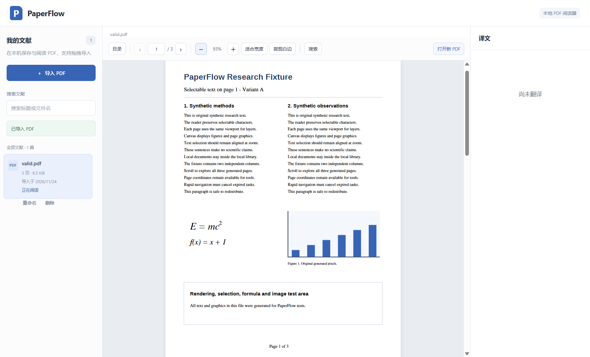

# PaperFlow

**面向科研论文的本地安全隔离双语 PDF 阅读器 · `AGPL-3.0-only` · `Windows x64 / Linux x64`**

PaperFlow 基于 **Electron 44 + React 19 + TypeScript + PDF.js 6.4 + SQLite（better-sqlite3）** 构建，聚焦「**本地优先、版面保真、安全隔离、兼容主流学术工作流**」的论文精读体验：

- 文献库存储、PDF 版面解析、自动大纲、图表裁剪速览、引用提取与便携备份全部运行在**本地且不依赖大模型**；
- 双语翻译与划句 AI 伴读通过 Electron 主进程受控代理接入 **OpenAI 兼容 API**（DeepSeek / OpenAI / 本机 Ollama 等）或 **本机 AI CLI**（Codex CLI / Claude CLI / Gemini CLI / 自定义 CLI），译文持久化缓存于本地 SQLite，API Key 经系统安全模块 `safeStorage` 加密保存；
- 渲染层始终保持零外网直连权限，严格启用 `sandbox` / `contextIsolation` / `webSecurity`，不引入 OCR 或 Python 翻译运行时依赖。



---

## 核心特性

### 1. 文献库管理与跨库检索
- **安全本地入库**：支持按钮选择或直接拖拽 `.pdf` 批量导入（单文件上限 100 MiB，主进程 SHA-256 去重与隐藏沙盒校验，渲染层不接触本机真实路径）。
- **轻量整理与进度追踪**：卡片悬停浮现快捷操作栏（星标收藏、自定义 `#标签`、内联重命名、确认删除），实时展示已读页码与进度条，支持按「全部 / ★ 收藏 / `#标签`」即时筛选。
- **跨库全局检索**：单个搜索框同时检索全库文献标题、标签、高亮批注/笔记及已缓存译文，命中结果点击直达对应文献与页码。

### 2. 三视图对照与护眼/深色阅读体验
- **固定顶栏 + 底部悬浮控制胶囊**：顶部工具栏固定不随分栏线抖动，支持一键切换 **「原文 / 双栏 / 译文」** 三种视图模式、收起/展开文献库，以及双栏 `25%–75%` 自由拖拽比例（双击恢复 1:1）与同步滚动锁定/解锁。
- **三套阅读主题（明亮 / 护眼 / 深色）**：
  - **护眼暖纸**：通过 `mix-blend-mode: multiply` 为 PDF 原页与译文页真实着暖米色，降低长时间阅读刺眼感；
  - **深色模式**：对 PDF 原页、译文底图与速览缩略图做柔和反色处理，同时保留高饱和四色高亮标注点与定制深色滚动条。
- **科研排版细节**：支持 `裁剪白边` 联动适宽阅读、`Ctrl+F` 取消式全文搜索、`Ctrl+滚轮` 缩放、跨页/双栏/公式/旋转页连续高亮以及 `forced-colors` 高对比度适配。

### 3. 原页底图覆写双语翻译与逐句双向联动
- **版面保真覆写**：右侧基于原页 `ImageBitmap` 底图完整保留矢量图表、表格与公式块（自动跳过 `formula` 块），按边缘采样的原块底色在安全列宽内原位覆写中文译文；点击或拖选左右任意一侧句子，对侧实时同步高亮。
- **双引擎与缓存体系**：主进程 `TranslationService` 受控代理 OpenAI 兼容接口或本机 AI CLI，支持单页翻译、单段重译、后台逐页「连续译」及自定义**专业术语表（Glossary）**；译文按 `(document_id, page_number, block_id, target_language)` 持久化缓存于本地 SQLite，避免重复请求。

### 4. 高频科研精读工具链
- **划句批注、笔记与 AI 伴读**：选中句子即可一键添加黄/绿/蓝/粉四色高亮或附带笔记，右侧悬浮批注抽屉支持按颜色筛选、点击回跳与一键导出 Markdown；配置引擎后可使用「AI 解释 / 解释公式」并将解析一键存为批注。
- **图表与参考文献速览 + 一键复制**：点击含 `Fig. N` / `Table N` / `[N]` / `(Author, YYYY)` 的句子自动提供速览入口。图表速览以 1.8× 离屏渲染并结合**逐行像素墨迹扫描 + 同栏正文段落硬边界截断**去除白边与邻近正文干扰，画幅优先铺满浮窗；支持**一键复制高清 PNG 图片、复制题注/引用文本**、点击正文或继续滚动自动收起以及「固定」常驻对照。
- **无书签 PDF 自动章节大纲**：对未内嵌书签的 PDF 自动扫描前 60 页文本与字号层级，自动剔除重复页眉、代码/表格噪点并在 `References` 后截断文献列表；点击任意目录标题即可跳转目标页并在原文/双栏/译文同步高亮定位该标题。
- **一键复制引用（BibTeX / IEEE / GB/T 7714 / RIS）**：结合 PDF 内嵌元数据、首页字号层级与多出版商（ACM / Springer / IEEE / arXiv / 中文论文）版面结构自动提取标题、作者、年份、期刊/会议与 DOI，支持手工微调并持久化到本地。
- **快捷键面板**：按 `?` 查看全部快捷键（`T` 切主题、`V` 切视图、`B` 收起文献库、`O` 目录、`A` 批注、`C` 引用、`H` 快速高亮、`Ctrl+F` 搜索、`←/→` 翻页、`Esc` 关闭浮窗）。

### 5. 适配主流文献阅读器的一键备份与恢复（`.zip`）
在文献库底部点击「一键备份 / 恢复备份」，内置零外部依赖的标准 PKZIP 引擎（UTF-8 文件名、CRC32 校验、Zip-Slip 路径防护与体积/条目上限），将整库打包为单个便携 `.zip` 文件：

| 备份包内路径 | 用途与生态兼容 |
| --- | --- |
| `pdfs/*.pdf` | 完整原始 PDF 副本（按标题规范命名，恢复时走 SHA-256 去重与完整性校验） |
| `library.bib` | 标准 BibTeX（含 `file` 附件路径与 `keywords` 标签），可直接导入 **Zotero / JabRef / Mendeley** |
| `library.ris` | 标准 RIS 格式（含 `L1` 附件与 `KW` 标签），可直接导入 **EndNote / Zotero / Mendeley** |
| `notes/*.md` | 各文献高亮与批注 Markdown 笔记，可直接拖入 **Obsidian / Notion / Logseq** |
| `paperflow-backup.json` | PaperFlow 无损恢复清单（文献元数据、星标/标签、阅读进度、批注及定位框、SQLite 译文缓存与自定义术语表，支持幂等恢复） |

> **安全说明**：便携 `.zip` 备份包刻意**不包含**已加密存储的翻译 API Key，防止分享或跨设备迁移备份时意外泄露个人凭据。

---

## 下载与本地构建

可在 GitHub Releases 获取已发布版本的预构建产物，或按以下方式从源码直接构建最新主分支（所有构建脚本严格保留 `--publish never`，不自动远程发布）。

### 环境要求
- Node.js `>= 24.0.0`
- pnpm `11.25.0`（版本由 `package.json` / `pnpm-lock.yaml` 固定）

### 从源码运行
```bash
pnpm install --frozen-lockfile
pnpm fixtures
pnpm dev
```

### 常用命令

| 命令 | 用途 |
| --- | --- |
| `pnpm dev` | 启动 Electron + Vite 开发窗口（React HMR） |
| `pnpm typecheck` | 主进程、Preload、Renderer、脚本与测试严格 TypeScript 校验 |
| `pnpm lint` | ESLint 静态检查 |
| `pnpm test` | 运行 Vitest 单元测试 |
| `pnpm test:e2e` | 运行 Playwright 真实 Electron 桌面端到端测试（需先执行 `pnpm build`） |
| `pnpm build` | 生产构建到 `out/` |
| `pnpm dist:win` | 构建 Windows x64 NSIS 安装包 `release/PaperFlow-<version>-win-x64-setup.exe`（`--publish never`） |
| `pnpm pack:win` | 构建 Windows 解包版 `release/win-unpacked/PaperFlow.exe`（`--publish never`） |
| `pnpm dist:linux` | 构建 Linux x64 便携 `.tar.gz`（支持跨平台构建并校验 Electron SHA-256 与 POSIX 权限） |
| `pnpm dist:linux:deb` | 在 Ubuntu/Debian 上封装 `release/PaperFlow-<version>-linux-x64.deb` |
| `pnpm fixtures` | 重新生成可再分发的原创合成测试 PDF |
| `pnpm rebuild:electron` | 在真实 Electron 中验证 `better-sqlite3` Node-API 兼容性 |

> 说明：`better-sqlite3` 13 附带 Node-API 10 预编译二进制，无需额外安装 Python / C++ 原生编译工具链。Windows 本地打包产物未进行商业代码签名（`NotSigned`），SmartScreen 提示时请核对 SHA-256 后运行；Linux 便携包在限制非特权 user namespace 的系统上需先对 `chrome-sandbox` 执行 `sudo chown root:root` 与 `sudo chmod 4755`。

---

## 本地数据与安全边界

### 数据目录
默认位于 Electron `app.getPath('userData')`（Windows 通常为 `%APPDATA%/PaperFlow`，Linux 通常为 `~/.config/PaperFlow`），亦可通过启动参数 `--user-data-dir=<绝对路径>` 指定独立便携目录：
- `paperflow.sqlite`：WAL 模式、外键开启、`user_version = 4`（支持 `v1→v4` 非破坏平滑迁移），包含 `documents`、`reader_state`、`translation_cache`、`app_settings`、`annotations` 五张表。
- `library/<UUID>.pdf`：本地文献副本，渲染层不接触绝对路径。

### 安全隔离约定
- 强制启用 `sandbox: true`、`contextIsolation: true`、`webSecurity: true`，禁用 `nodeIntegration`、外部页面导航、弹窗与渲染层权限请求；
- Preload 仅暴露 30 个冻结的 `window.paperflow` 业务方法；主进程 IPC 逐一校验窗口来源、主 frame、精确协议 URL（`app://bundle`）与 Zod 入参（含剪贴板、URL 协议与 CLI 参数元字符拦截）；
- PDF 解析与渲染使用本地打包的 PDF.js Worker、CMaps 与 WASM，不加载任何外部 CDN，不执行 PDF 外部链接或表单脚本；外部翻译 API 与本机 CLI 仅在主进程 `TranslationService` 内受控执行。

---

## 测试与验证边界

- **测试素材**：仓库内所有测试 PDF（见 [tests/fixtures/README.md](tests/fixtures/README.md)）均为原创合成测试数据，不复制任何受版权保护的真实论文。
- **当前主分支实测记录**：
  - `pnpm typecheck`（0 错误）、`pnpm lint --max-warnings=0`（0 警告）；
  - Vitest 单元测试：**16 个测试文件 / 136 项测试全部通过**（涵盖数据库迁移与健壮性、版面分析与双向对齐、翻译服务与密钥保护、紧致图表裁剪、无噪点自动大纲、多出版商引用提取与 ZIP 备份恢复）；
  - Playwright 真实 Electron 端到端测试：开发态 **11 / 11 通过**，打包成品 `PaperFlow.exe` 核心回归（含系统剪贴板 PNG/文本写入、Windows `Expand-Archive` 备份解压互通与双实例跨空库还原）**3 / 3 通过**，E2E 全局清理后 `%TEMP%\paperflow-*` 残留为 0。
- **模拟与未覆盖说明**：E2E 中系统原生打开/保存文件对话框通过 `dialog.showOpenDialog` / `showSaveDialog` 指定路径，双语翻译 E2E 通过本机 `127.0.0.1` 模拟 OpenAI 兼容服务端与本地 Node CLI 桩验证；真实公网第三方 API 稳定性、跨 Linux/macOS 新版打包验证视具体环境另行补充。

---

## 目录导航

| 路径 | 说明 |
| --- | --- |
| [src/main/](src/main/) | Electron 主进程入口、协议与安全策略、IPC 注册、SQLite 数据库、文献管理、双引擎翻译与 ZIP 备份服务 |
| [src/preload/](src/preload/) | 最小受控 `window.paperflow` 桥接层 |
| [src/renderer/](src/renderer/) | React 阅读器界面（文献库、PDF 渲染与版面分析、双栏译文对照、批注/速览/引用/快捷键模块、三套主题） |
| [src/shared/](src/shared/) | 跨进程契约、Zod 校验 Schema 与共享引用格式化模块 |
| [tests/](tests/) · [scripts/](scripts/) | 单元测试、Electron E2E 测试、合成 PDF 生成器与多平台打包脚本 |
| [docs/](docs/) | 架构设计、历史发布验证记录与预览截图 |
| [CHANGELOG.md](CHANGELOG.md) | 历史版本更新日志 |

---

## 许可证

自有代码采用 [AGPL-3.0-only](LICENSE) 开源许可。第三方依赖与随包资源版权及许可见 [docs/third-party-licenses.md](docs/third-party-licenses.md)、`resources/THIRD-PARTY-NOTICES.txt` 与 `resources/licenses/`。
