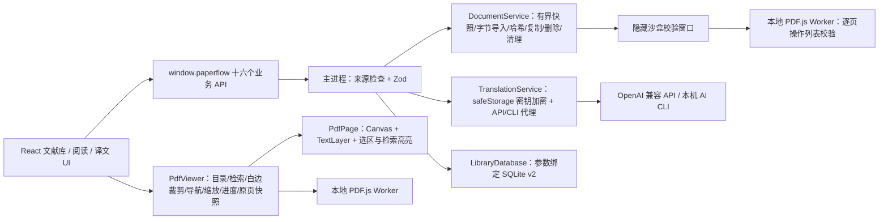

# Foliopair（原 PaperFlow）架构说明

> 更新注记（`v0.2.1`，2026-11-28）：界面与品牌已更名为 **Foliopair**。为兼容升级，沿用 `org.paperflow.desktop`、`appData/PaperFlow` 下的 `paperflow.sqlite`、ZIP 内的 `paperflow-backup.json` 和 `window.paperflow` 桥接契约。Preload 扩展至 **67** 个业务 API，新增 `setWindowTheme` 联动融合标题栏。SQLite `user_version` 为 7，含文档摘要缓存。该版本新增单/双栏分段翻译、跨页/跨批次翻译语境、自定义快捷键、按 Base URL 绑定凭据和本机 CLI 授权确认。

本说明记录 Foliopair T01–T06 基础架构与选区、坐标边界。构建、实机与打包验收以 `implementation-notes.md` 和 `verification/summary.md` 的实际命令和结果为准。

## 进程与模块

项目保持 electron-vite 的主进程、Preload、Renderer 三层入口。导入时另建一个隐藏、独立沙盒的校验窗口；PDF 解析不在拥有文件系统权限的主进程中执行；外部 AI 翻译与学术检索请求仅通过主进程服务受控代理执行，渲染层保持零外网直连权限。



| 目录/文件 | 责任 |
| --- | --- |
| `src/main/index.ts` | 应用启动、`userData` 路径、启动孤立副本回收（`cleanupOrphanFiles`）、`TranslationService` 与 `LibraryDatabase` 装配、退出前任务取消与关闭 |
| `src/main/window.ts` | 1440×900 主窗口、最小尺寸、安全策略、关闭前进度刷新 |
| `src/main/services/app-protocol.ts` | 注册 `app://`、构建资源清单与 CSP |
| `src/main/ipc/index.ts` | 十六个业务 handler；校验受信窗口、`mainFrame`、精确 URL、参数与 `safeStorage` 装配 |
| `src/main/services/document-service.ts` | 文件快照/字节导入、扩展名/头/大小检查、SHA-256、去重、临时文件、库副本、级联删除与孤立文件清理 |
| `src/main/services/translation-service.ts` | OpenAI 兼容 HTTP 翻译（`fetch`）与本机 AI CLI 解析执行（Codex / Claude / Gemini / 自定义 CLI），结合 Electron `safeStorage` 加密存密与 SQLite 块级缓存 |
| `src/main/services/database.ts` | `user_version = 2` 四张业务表（含 v1→v2 非破坏升级）、设置与译文缓存持久化、级联删除与参数绑定 SQL |
| `src/main/services/pdf-validation.ts` | 隐藏校验窗口、20 秒超时、专用返回信道与资源销毁 |
| `src/preload/index.ts` | 仅暴露十六个 `window.paperflow` 业务方法，没有原始 IPC、路径、密钥读取或 Node API |
| `src/preload/validation.ts` | 校验窗口专用一次性字节接收与结果报告，不暴露业务 API |
| `src/renderer/validation.ts` | 调用 PDF.js，逐页获取操作列表，报告页数/友好错误 |
| `src/renderer/src/App.tsx` | 可折叠文献库侧边栏、打开文献默认 1:1 等宽双栏 / 单栏切换、双栏拖曳分屏、译文缓存预加载与多页状态协调、`.workspace` 文件拖拽导入 |
| `src/renderer/src/features/library/` | 文献列表、导入/拖拽批量反馈、搜索过滤、内联重命名、确认删除与最近选择 |
| `src/renderer/src/features/reader/` | PDF 生命周期、Canvas/TextLayer 与 `ImageBitmap` 底图快照回传、目录抽屉、惰性全文搜索、`Ctrl+滚轮`/快捷键、白边裁剪、多栏版面分析与底色采样、跨页/旋转连选 SVG 与 `forced-colors` 适配 |
| `src/renderer/src/features/translation/` | 空态保留「尚未翻译」占位；打开文献后在右栏渲染原页底图 Canvas + 原位自适应覆写中文译文层（`OverlayPageContent`，保留矢量图表与公式）、未译/公式句级镜像热区、自然句双向对齐联动（`sentence-alignment.ts`）、翻译引擎设置弹窗（`TranslationSettingsModal`）与双向同步滑动控件（`scroll-sync.ts`、`useDualScrollSync.ts`） |
| `src/shared/` | 业务契约（16 个 API、共享字节格式化与控制字符检查）与 Zod 输入模型（含 HTTP(S) URL 与安全 CLI token 校验） |

不引入全局大型状态框架；React 状态按文献库、文档、单页与翻译设置分开。仍不引入 OCR、Python 翻译运行时或自动远程发布。

## 安全边界

主窗口与校验窗口均启用 `sandbox: true`、`contextIsolation: true`、`nodeIntegration: false`、`webSecurity: true`；不以关闭 Chromium 安全机制修复加载。Preload 使用 electron-vite 独立入口构建为 CJS 单文件，依赖完整打包，运行时只依赖沙盒允许的 Electron 模块。

生产入口为 `app://bundle/index.html`，校验器为 `app://bundle/validation.html`。协议在 ready 前注册为 standard/secure，支持本地 fetch，不设置 `bypassCSP`。handler 只服务启动时枚举的构建资源，校验 host、方法、路径和查询串；文献库与任意磁盘文件不在资源清单中。开发入口只接受固定 `http://127.0.0.1:5173`，生产忽略开发服务器环境变量。

网络请求按来源白名单拦截：渲染层在生产环境仅允许应用资源与内部 data/blob/devtools 用途（开发另允许固定 Vite HTTP/WebSocket），**保持无外部翻译 API 直连权限**。CSP 默认拒绝，脚本与 Worker 限同源；PDF 字体需要本地 blob/data，PDF.js 的位置样式需要行内 style，WASM 解码使用 `wasm-unsafe-eval`。不启用普通 JavaScript `unsafe-eval`。页面导航、子 frame 导航、弹窗、webview 与系统权限请求均拒绝。PDF 只渲染页面与文字，不建立链接/脚本执行层，不调用 `shell.openExternal`。

业务 handler 每次校验调用者 `webContents` 身份、`senderFrame === mainFrame` 和精确受信 URL，而非 URL 前缀。参数由 Zod 校验；renderer 无法指定本地路径、任意 IPC channel 或任意系统 Shell 命令。**OpenAI 兼容 HTTP 翻译（限定 `http:`/`https:` URL）与本机 AI CLI 进程唤醒均由主进程 `TranslationService` 受控执行**：CLI 命令须通过纯文件系统 `PATH` 解析（`resolveCliExecutable`）并结合 Zod 严格拦截 Shell 注入元字符（`[&|<>^%!\r\n\`$;]`），提示词通过 `stdin` 管道传入空隔离临时目录并在超时/取消时终止进程树；OpenAI 密钥在主进程侧通过 Electron `safeStorage` 加密存于 SQLite `app_settings`，永不将明文密钥传回渲染层（仅返回脱敏摘要 `apiKeyPreview`）。专用校验结果 handler 只接受对应隐藏窗口与精确校验 URL，随后校验返回结构。

这些措施缩小权限边界，不意味着对所有恶意 PDF、Chromium 漏洞或资源耗尽已作形式化安全证明。依赖升级仍需重新测试。

## IPC 业务契约

`src/shared/contracts.ts` 的 `PaperFlowAPI` 通过 `contextBridge` 暴露十六个业务方法。PDF 字节是 `Uint8Array`，界面不会获得文献绝对路径、内部文件名或原始 API 密钥。

| API | channel | 校验与行为 |
| --- | --- | --- |
| `importPdf()` | `document:import` | 无参数；系统文件框取消返回 null；成功返回 imported/existing 与公开文献记录 |
| `importPdfBytes(input)` | `document:import-bytes` | `{ originalFilename, bytes }`；校验 1–260 字符不含路径分隔符或控制字符的 `.pdf` 文件名、IPC 有界 `Uint8Array`（≤105 MiB 上限，实际 PDF 上限仍为 100 MiB）与 PDF 头，供拖拽导入复用同一提交与沙盒校验路径 |
| `listDocuments()` | `document:list` | 无参数；按导入时间返回公开记录 |
| `readPdfBytes(documentId)` | `document:read` | UUID；只读已入库文献，验证库副本和哈希 |
| `updatePageCount(documentId, pageCount)` | `document:page-count` | UUID、1–1,000,000 的整数；更新页数并约束已有进度 |
| `renameDocument(documentId, displayTitle)` | `document:rename` | UUID 与 1–200 字符去首尾空白且不含控制字符（`0x00–0x1F` / `0x7F`）的显示标题；返回更新后的公开记录 |
| `deleteDocument(documentId)` | `document:delete` | UUID；删除 SQLite 记录（外键 `ON DELETE CASCADE` 联动清除 `reader_state` 与 `translation_cache` 并中止该文献在途翻译任务），并校验 `storedFilename === <id>.pdf`、非符号链接与 `realpath` 在 `library/` 内后移除副本 |
| `getReaderState(documentId)` | `reader:get` | UUID 且文献存在；返回状态或 null |
| `saveReaderState(state)` | `reader:save` | 严格对象；UUID、有效页码、0.5–3 的有限倍率、ISO 时间；数据库使用主进程时间 |
| `getTranslationSettings()` | `translation:get-settings` | 无参数；返回当前供应商类型、目标语言、Base URL/模型、`hasApiKey`/`apiKeyPreview`（永不返回明文密钥）与 CLI 配置 |
| `saveTranslationSettings(input)` | `translation:save-settings` | 严格 Zod 校验：`http:`/`https:` Base URL、禁止元字符的 CLI 命令与参数元组、`timeoutSec`（10–300）；新 API Key 经 `safeStorage` 加密落盘，传空字符串时清除密钥 |
| `testTranslationConnection()` | `translation:test` | 无参数；按已保存配置向 OpenAI 兼容端点发送最小测试消息或探活本机 CLI 可执行路径，返回耗时、样本输出或错误与解析路径 |
| `getPageTranslations(documentId, pageNumber)` | `translation:get-page` | UUID 与有效页码；按当前目标语言返回该页已缓存的 `TranslatedBlockRecord[]` |
| `translatePage(input)` | `translation:translate-page` | UUID、页码、待译文本块列表（`blockId`/`kind`/`sourceText`/`sourceHash`）与可选 `force`；优先命中 `translation_cache`，按字符/块数分批调用翻译引擎、失败回退单块并持久化缓存 |
| `cancelTranslation(documentId?)` | `translation:cancel` | 可选 UUID；中止全部或指定文献的在途 `AbortController` 请求与 CLI 子进程树 |
| `clearDocumentTranslations(documentId)` | `translation:clear-document` | UUID；清空指定文献的全部本地 SQLite 译文缓存记录 |

`DocumentRecord` 只含 ID、原文件名、显示标题、字节数、页数与导入时间。所有 SQL 值使用位置或命名参数绑定；建表迁移 SQL 是应用内固定文本。

## 本地存储与导入一致性

默认文件位于 Electron `app.getPath('userData')`：

```text
userData/
  paperflow.sqlite
  paperflow.sqlite-wal / paperflow.sqlite-shm  （数据库打开时可能存在）
  library/
    <UUID>.pdf
```

主进程支持绝对路径的 `--user-data-dir` 启动参数，供隔离测试或本机自选数据目录使用；renderer 不提供路径配置接口。数据库不写入安装目录。

`PRAGMA user_version = 2` 管理建表与非破坏升级事务（支持从 `v0` 全新初始化以及从 `v1` 平滑升级并保留已有文献与阅读进度；拒绝未来未知版本）。启用外键、WAL、5 秒 busy timeout。核心业务表共四张：

| 表 | 字段与约束 |
| --- | --- |
| `documents` | UUID `id` 主键；唯一 `sha256`、唯一 `stored_filename`；`original_filename`、`display_title`、`byte_size`、可空 `page_count`、`imported_at` |
| `reader_state` | `document_id` 主键并外键关联文献（`ON DELETE CASCADE`）；从 1 开始的 `page_number`；0.5–3 的 `scale`；`updated_at` |
| `translation_cache` | `(document_id, page_number, block_id, target_language)` 复合主键并外键关联文献（`ON DELETE CASCADE`）；存储 `source_hash`、`provider_signature`、`translated_text`、`updated_at` 与lookup索引 |
| `app_settings` | 键值对配置表（`key` 主键、`value`、`updated_at`），保存翻译配置 JSON 与经 `safeStorage` 加密后的 Base64 密钥 |

导入串行排队。主进程以一个有界快照读取源文件，限制 **100 MiB（104,857,600 字节）**，检查普通文件、`.pdf` 扩展名与 `%PDF-1.x`/`%PDF-2.x` 文件头，并比较读取前后大小和修改时间。哈希与写入使用同一份字节，源文件不修改。

相同 SHA-256 返回现有记录，并先检查已有副本可读；同名不同内容按不同 UUID 共存。新文件（无论来自原生文件框 `importFile` 还是渲染层拖拽读取字节 `importBuffer`）均共用 `commitPdfBytes()`：先交隐藏沙盒 PDF.js 校验器逐页构造操作列表，拒绝已加密、无法解析或超时的文件，校验成功后写入排他创建的临时文件、flush、重命名，再写数据库。可捕获的复制/数据库失败会清理临时文件及未提交副本，并在错误文本中保留原文件名与可读超限大小。此外，`main/index.ts` 在启动创建主窗口前运行 `cleanupOrphanFiles()`，仅清理 `library/` 下未入库的 `<uuid>.pdf` 与残留 `.<uuid>.tmp` 普通文件，不触碰其他用户文件。

库存读取与删除均要求数据库命名匹配 `<id>.pdf`，拒绝符号链接和非普通文件，检查 `realpath` 位于 `library/` 目录内；读取另核对大小、文件头及 SHA-256。PDF.js 仍可能修复或容忍部分非标准结构；导入校验不等同于 PDF 标准全项一致性验证。合法但复杂的文件也可能因 20 秒时限被拒绝。

better-sqlite3 **13.0.3** 的本机 `binding.gyp` 使用 `NAPI_VERSION=10`，并自带平台预编译模块。当前工程采用 Node-API 兼容路径，非传统每个 Electron V8 ABI 都重新编译；`npmRebuild: false` 避免误触发旧式 rebuild。`pnpm rebuild:electron` 是实际加载与 SQLite 查询验证脚本，并非假装执行原生重编译。未来换版本、平台或架构必须重新检查二进制存在性和运行兼容性；`.node` 在打包时解包到 ASAR 外。

## 阅读器生命周期、文字与资源

`pdf-engine.ts` 为每个文档显式创建本地模块 Worker，再用 `PDFWorker.create({ port })` 传给 `getDocument`。原因是标准 URL API 对 `app://` 的 origin 返回 null，单靠 `workerSrc` 会触发 PDF.js 跨源 blob 包装并与严格 Worker CSP 冲突。销毁封装幂等调用 loading task 销毁、PDFWorker 销毁和物理 Worker terminate，不长期退化成 fake Worker。CMaps、标准字体、ICC profile 和图像解码 WASM 均随包，不依赖 CDN。

`PdfViewer` 从 IPC 获取字节与保存状态，维护 `PDFDocumentProxy`、当前页、缩放、加载/错误状态，并在顶部栏按自定义标题优先展示文献名（`displayTitle`）。首次未保存状态时按可用宽度计算倍率，普通缩放限制在 50%–300%。连续纵向滚动更新当前页；工具栏与快捷键支持：
- **目录书签抽屉**（`pdf-outline.ts`、`PdfOutline.tsx`）：仅解析 PDF 内部目标（`getDestination` + `getPageIndex`），忽略纯外部 `item.url` 链接，空目录显式提示“此 PDF 未包含目录书签”。
- **文内检索**（`pdf-search.ts`、`PdfSearchBar.tsx`，`Ctrl+F`）：`PdfSearchService` 按页通过 `getTextContent()` 惰性缓存 UTF-16 索引与 `spans`，不触发离屏 Canvas 渲染；支持异步取消、`yieldEvery` 分片让出事件循环、大小写切换、`Enter`/`Shift+Enter`/`Escape` 切换与关闭，并在每页 `.pdf-highlight-layer` 绘制 `.pdf-search-match` / `.pdf-search-match--active` 与自动居中滚动。
- **缩放与键盘操作**：支持阅读区 `Ctrl/Meta + 滚轮`缩放，以及焦点在 `.reader-panel` 时的 `Ctrl+=`/`-`/`0`、`ArrowLeft`/`ArrowRight`/`PageUp`/`PageDown`/`Home`/`End`（输入框等可编辑元素内保持原行为）。
- **白边裁剪阅读**（`margin-crop.ts`）：在页面首个可用 Canvas 上执行 `measureCanvasCropInsets` 扫描非空白 ink 包围盒（单边上限 `0.35`、单轴上限 `0.65`），开启“裁剪白边”时仅调整 `.pdf-page` 裁剪视框与 `.pdf-page-mount` 偏移，并在「适合宽度」计算中折减水平白边，不改动 `PageViewport` 与双坐标投影。

`PdfPage` 用 IntersectionObserver 在阅读视口上下 800px 范围内渲染，离屏销毁物理像素与文字层 DOM。每页保留布局占位，按实际 page viewport 修正不同尺寸；当前实现是 Canvas 按需渲染，并非完整的页面 DOM 虚拟列表。极端超长文档的占位 DOM 开销仍需后续性能验收。

混合页的真实尺寸可能改变前方占位高度。程序跳页、恢复和缩放使用可取消的目标锚定，由一个 ResizeObserver 观察逐页尺寸并补偿位置；只在锚定期间关闭浏览器自动滚动锚定，避免两者同时调整。用户滚轮、指针、触摸、导航键或其他非本次补偿的滚动会取消旧目标；文献身份与命令序号防止过期缩放提交重新定位。Canvas 懒渲染范围未因此放大，onPageData 借用语义保持不变。DPR3 的四秒被动位置观察、真实滚轮与最新跳页回归见补充验收报告；未以静态审阅代替物理输入测试。

单页 Canvas 与官方 `TextLayer` 使用同一个 `PageViewport`。Canvas 物理像素按设备像素比缩放，并受 8 Mi 像素与 8192 单边限制；文字、选区和未来覆盖层始终使用 CSS 像素，不误乘 DPR。文本来自 `getTextContent`，交给官方 TextLayer 构造 DOM，不通过不可信 HTML 注入。Canvas 字体加载完成后再测量文字层，支持真实文字选择与复制。无可提取文字的页面正常显示图像并提示暂不支持 OCR。

每轮渲染使用独立 Canvas/DOM，同页后继任务等待旧任务完成。清理取消 RenderTask 和 TextLayer，等待已启动 Promise 结束后再 page cleanup，避免旧任务覆盖新页面。页面级失败显示错误；文档加载错误、密码文献均有友好提示。

阅读进度通过 `useReaderPersistence` 以 450ms 防抖串行保存；切换卸载主动 flush。关闭窗口发固定本地事件，等待进度保存，最长 2 秒后继续关闭；数据库在 `will-quit` 阶段关闭。突然终止进程、断电、磁盘写入失败或超过关闭等待时限时，最后未落库状态不作保证。最近文献 ID 存于应用来源 localStorage；页码和缩放在 SQLite。

## T04–T08 可复用接口

以下渲染层坐标与快照接口供版面分析、选区桥接及原页底图译文叠加复用。

| 接口 | 数据与用途 |
| --- | --- |
| `PdfViewerProps.onPageData` / `PdfPageProps.onPageData` | 页面就绪时借用 `PdfPageData`；离屏、缩放或卸载时传 null 撤销，调用者不得长期保留过期资源 |
| `PdfPageData` | `geometry`、原始 `textContent`、官方 `TextLayer`、页面 `canvas` 与 `element` |
| `PageTextContent` | `PDFPageProxy.getTextContent` 返回类型，保留 items、文本样式和文字 transform；不能把每个 item 默认等同一句话 |
| `PageGeometry` | 页码、完整 `PageViewport`、Canvas `outputScale`；统一旋转、CropBox、UserUnit 与缩放信息 |
| `pdfPointToViewport` / `viewportPointToPdf` | PDF 坐标与页面局部 CSS 坐标双向转换 |
| `pdfRectToViewport` / `viewportRectToPdf` | 变换矩形四角后求边界，兼容页面固有旋转 |
| `clientPointToPdf` | 客户区鼠标坐标减页面边界并转换回 PDF 坐标 |
| `selectionToPdfRects` | 将真实 DOM Selection 分页裁剪，输出 `{ pageNumber, rect }` 的 PDF 坐标矩形 |

### 空白区域的鼠标选择边界与跨页/旋转/高对比度连续高亮

`text-selection.ts` 在已渲染页面注册官方 TextLayer 的公开文字节点，保留原始 `textContent`、DOM 顺序及 `onPageData` 借用接口。主键从阅读区空白起拖时不建立文字选区；文字起拖后进入空白，将端点限制到实际指针路径经过的最后一个文字节点。字符 Range 用于验证命中，避免把透明整页或整行的外框当成文字。

针对公式、旋转页面与跨页连选场景，`selection-bridges.ts` 与 `selection-highlight.ts` 在同页统一 SVG 路径 `.pdf-selection-shape`（`fill-opacity: 0.36`）内合并原始字符框与补间矩形：
- **视觉显示投影与旋转支持**：通过 `composeAffine(viewport.transform, item.transform)`、`displayScaleForViewport`（`viewport.scale * viewport.userUnit`）、`projectVisualRun`、`viewportToDisplayRect` 与 `displayToViewportRect` 将文字运行与选区矩形映射至未缩放的视觉显示空间，统一处理 0°/90°/180°/270° 页面旋转、`CropBox` 与 `UserUnit`，保持宽高下标与行内公式的连续桥接。
- **跨页与端点守卫**：`selectedPart()` 增加 `comparePoint` 叶节点守卫；当选区跨越两页及以上（`activePages > 1 || startPage !== endPage`）时，即使某页仅选中单行文字、`bridges.length === 0`，也统一启用 `.pdf-selection-shape` 绘制。
- **高对比度适配**：`forced-colors.css` 在 `@media (forced-colors: active)` 下为 `.pdf-selection-shape` 设置 `forced-color-adjust: none`、`fill: Highlight`、`fill-opacity: 0.36`、`stroke: none`，并抑制冗余原生背景涂抹，在系统高对比度主题下保留下层 PDF Canvas 字符清晰度，同时增强选中列表项、聚焦环、搜索命中、句卡高亮及同步锁定按钮边界。

已观察到 PointerEvent 保留小数坐标而兼容 MouseEvent 截为整数的情况。控制器仅给紧随其后、类型/目标/按钮/可信状态匹配的兼容事件消费一次准确指针坐标；不匹配则使用原鼠标坐标，失焦、取消和最终注销会清理缓存。这项处理不扩大字符框容差。

快速移动沿指针线段作有限局部采样（约 2 CSS 像素，最多 1024 次），不是对任意字号、距离和内容顺序的保证。公式仍取自 PDF 的真实可提取字符，矢量分数线不伪造成文本，也不生成 LaTeX。双击、带修饰键的选择和复制沿用浏览器；阅读工具栏与原生滚动条不纳入空白拦截。

页面离屏、缩放或卸载时幂等撤销注册，最后一页撤销时终止共享事件监听器；有效手势绑定实际起拖文字层，灰色页外空白绑定阅读根容器。具体行为是否通过以本轮 QA 的真实鼠标记录为准，静态架构说明不代替测试结果。

实现位置为 `pdf-geometry.ts`、`selection-bridges.ts`、`selection-highlight.ts`、`forced-colors.css`、`PdfPage.tsx` 与 `PdfViewer.tsx`。未来高亮层仍以未缩放 PDF 坐标为准，显示时实时转换。

### 多栏版面分析、原页底图译文覆写、引擎代理与双栏同步滑动

根据 2026-11-24 授权放开的 T04–T06 阶段范围，`layout-analysis.ts` 通过 `PdfViewer` 的 `onPageData` 与 `onPageBackdrop` 借用入口同步提取纯坐标结果 `PageLayoutResult` 与页面 `ImageBitmap` 底图（不持有过期 `PDFPageProxy` 或 DOM 引用，缩放/离屏/切文档时显式 `.close()` 回收并清空状态），配合主进程 `TranslationService` 完成完整双语对照阅读：

1. **多栏版面分析与底色采样（`layout-analysis.ts`）**：
   - 将 PDF.js `textContent` 通过 `composeAffine(viewport.transform, item.transform)` 与 `viewportRectToPdf` 映射至未缩放视觉显示坐标与 PDF 用户坐标，支持 0°/90°/180°/270° 页面旋转、CropBox 与 UserUnit。
   - 过滤空白项、边缘垂直印记（`margin-stamp`）、页眉、页脚与页码，并提供跨页重复边缘块精炼（`refineDocumentHeadersFooters`）。
   - 采用基于跨幅宽行分带的 XY-Cut 重建多栏阅读序，识别 `heading`、`paragraph`、`caption`、`formula` 与 `list-item` 语义块；执行断词连字符拼接（保留 `self-`/`non-` 等复合前缀）、同 Band 跨栏未完句合并（`crossColumn: true`）、缩写/小数保护，计算基于坐标与文本的稳定块缓存键 `computeStableTranslationBlockKey` 与 64 位源签名 `hashTranslationBlockSource`。
   - `sampleBlockBackgroundColors` 在页面 Canvas 就绪瞬时采样待译块边缘像素中位底色，用于无痕覆写彩底或白底块。
2. **1:1 对称双栏、原页底图覆写与逐句双向联动（`App.tsx`、`TranslationPanel.tsx`、`sentence-alignment.ts`）**：
   - 顶部支持一键「收起文献库 / 展开文献库」；打开文献默认进入 **1:1 等宽双栏对照**（拖曳分屏隔断条可在 `0.25–0.75` 间调整比例、双击恢复 1:1，工具栏支持切换「双栏对照 / 单栏精读」）。
   - 未打开文献时保持 `.panel-heading` 与「尚未翻译」空态；打开文献后，`.translation-header` 通过 `ResizeObserver` 与左栏下沿像素对齐。
   - `.translation-page` 同步左侧尺寸、缩放与 `裁剪白边` 偏移，底层由 `MirrorBackdropCanvas` 绘制原 PDF 页面 `ImageBitmap` 完整保留矢量图表、表格与公式（`formula` 块保留底图并叠加透明 `.translation-mirror-sentence` 热区）；`OverlayPageContent` 为跨栏空尾块提供精确非重叠背景遮罩（`.translation-overlay-mask`），对已译中文块先在不侵占邻列/Formula 的前提下尝试同栏右边界安全展宽，再渐进缩微字号（最低 `5.5px` / `line-height: 1.08`）以实现 **0px 纵向漂移**。
   - **双向逐句对照高亮（`sentence-alignment.ts`、`PdfViewer.tsx`）**：已译块按中英文自然句切分并与原文句子 1:1 或区间比例双向对齐；未译块与公式块提供透明 `.translation-mirror-sentence` 热区。**左 → 右**：点击左侧原文句子在两侧同步高亮对应句；左侧拖选文字通过 `selectionchange` 与 `selectionToPdfRects` 反查覆盖句并仅在右侧同步高亮（不干扰左侧原生蓝底选区）。**右 → 左**：点击任意译文句段（`translation-overlay-sentence`）、未译热区或拖选译文文字，均在左侧 `.pdf-highlight-layer` 同步绘制精准 `.pdf-sentence-highlight` 并保持双栏句对交互对称（按 `Escape` 或点击空白清除）。
3. **主进程双引擎翻译代理与安全存密（`TranslationService`、`TranslationSettingsModal.tsx`）**：
   - 支持 **OpenAI 兼容 API**（DeepSeek / OpenAI / 本机 Ollama 等，主进程原生 `fetch`）与 **本机 AI CLI**（Codex / Claude / Gemini / 自定义 CLI，`resolveCliExecutable` 纯文件系统检索 + `stdin` 传参 + 空临时工作目录 + 进程树取消清理），由 Zod 严检 URL 协议与 CLI 安全 token。
   - OpenAI API Key 经 Electron `safeStorage` 加密存盘于 `app_settings`，仅向前端暴露 `hasApiKey` 与 `apiKeyPreview`；译文按 `SOURCE_HASH` 分批翻译与单块稳健回退后落盘 SQLite `translation_cache`，切页/重启优先读缓存。
4. **双栏同步滑动锁定/解锁（`scroll-sync.ts`、`useDualScrollSync.ts`）**：
   - 默认开启「同步锁定」，纵向 1:1 像素对齐、横向按双向溢出比例映射，以时效窗 `isEchoScroll` 消除来回回声；手动切为「自由滑动」后两侧独立滚动，重锁时自动从左侧同步校准右侧。

扫描页 OCR、Python 翻译运行时依赖与自动远程发布仍严格不在实现范围内（`--publish never` 保持生效）。

架构依据：[Electron 安全建议](https://www.electronjs.org/docs/latest/tutorial/security/)、[Electron 自定义协议](https://www.electronjs.org/docs/latest/api/protocol)、[electron-vite 依赖处理](https://electron-vite.org/guide/dependency-handling)、[PDF.js 官方示例](https://mozilla.github.io/pdf.js/examples/)。具体行为以本项目锁定版本源码和测试为准。
