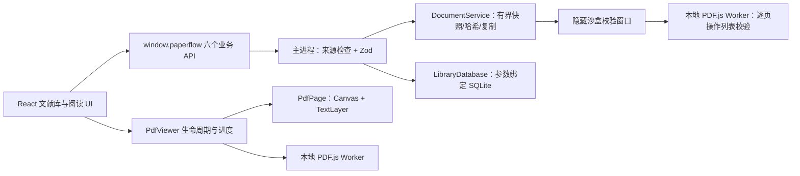

# PaperFlow 架构说明

本说明对应 T01–T03 源码，日期为 2026-10-27；描述实现边界，不替代测试结论。构建、实机与打包验收以 `implementation-notes.md` 的实际命令和结果为准。

## 进程与模块

项目保持 electron-vite 的主进程、Preload、Renderer 三层入口。导入时另建一个隐藏、独立沙盒的校验窗口；PDF 解析不在拥有文件系统权限的主进程中执行。



| 目录/文件 | 责任 |
| --- | --- |
| `src/main/index.ts` | 应用启动、userData 路径、服务装配与数据库关闭 |
| `src/main/window.ts` | 1440×900 主窗口、最小尺寸、安全策略、关闭前进度刷新 |
| `src/main/services/app-protocol.ts` | 注册 `app://`、构建资源清单与 CSP |
| `src/main/ipc/index.ts` | 六个业务 handler；校验受信窗口、mainFrame、精确 URL、参数 |
| `src/main/services/document-service.ts` | 文件快照、扩展名/头/大小检查、SHA-256、去重、临时文件与库副本 |
| `src/main/services/database.ts` | 业务表、迁移、持久化与参数绑定 SQL |
| `src/main/services/pdf-validation.ts` | 隐藏校验窗口、20 秒超时、专用返回信道与资源销毁 |
| `src/preload/index.ts` | 仅暴露 `window.paperflow`，没有原始 IPC、路径或 Node API |
| `src/preload/validation.ts` | 校验窗口专用一次性字节接收与结果报告，不暴露业务 API |
| `src/renderer/validation.ts` | 调用 PDF.js，逐页获取操作列表，报告页数/友好错误 |
| `src/renderer/src/features/library/` | 文献列表、导入状态、错误提示与最近选择 |
| `src/renderer/src/features/reader/` | PDF 生命周期、真实 Canvas/TextLayer、导航、缩放、坐标和进度 |
| `src/renderer/src/features/translation/` | 独立滚动的“尚未翻译”容器 |
| `src/shared/` | 业务契约与 Zod 输入模型，避免进程间重复定义 |

不引入全局大型状态框架；React 状态按文献库、文档、单页分开。当前无翻译、OCR、账户、网络同步或外部论文服务。

## 安全边界

主窗口与校验窗口均启用 `sandbox: true`、`contextIsolation: true`、`nodeIntegration: false`、`webSecurity: true`；不以关闭 Chromium 安全机制修复加载。Preload 使用 electron-vite 独立入口构建为 CJS 单文件，依赖完整打包，运行时只依赖沙盒允许的 Electron 模块。

生产入口为 `app://bundle/index.html`，校验器为 `app://bundle/validation.html`。协议在 ready 前注册为 standard/secure，支持本地 fetch，不设置 `bypassCSP`。handler 只服务启动时枚举的构建资源，校验 host、方法、路径和查询串；文献库与任意磁盘文件不在资源清单中。开发入口只接受固定 `http://127.0.0.1:5173`，生产忽略开发服务器环境变量。

网络请求按来源白名单拦截，生产仅允许应用资源与内部 data/blob/devtools 用途；开发另允许固定 Vite HTTP/WebSocket。CSP 默认拒绝，脚本与 Worker 限同源；PDF 字体需要本地 blob/data，PDF.js 的位置样式需要行内 style，WASM 解码使用 `wasm-unsafe-eval`。不启用普通 JavaScript `unsafe-eval`。页面导航、子 frame 导航、弹窗、webview 与系统权限请求均拒绝。PDF 只渲染页面与文字，不建立链接/脚本执行层，不调用 `shell.openExternal`。

业务 handler 每次校验调用者 `webContents` 身份、`senderFrame === mainFrame` 和精确受信 URL，而非 URL 前缀。参数由 Zod 校验；renderer 无法指定本地路径、任意 IPC channel 或系统命令。专用校验结果 handler 只接受对应隐藏窗口与精确校验 URL，随后校验返回结构。

这些措施缩小权限边界，不意味着对所有恶意 PDF、Chromium 漏洞或资源耗尽已作形式化安全证明。依赖升级仍需重新测试。

## IPC 业务契约

`src/shared/contracts.ts` 的 `PaperFlowAPI` 通过 `contextBridge` 暴露。PDF 字节是 `Uint8Array`，界面不会获得文献绝对路径或内部文件名。

| API | channel | 校验与行为 |
| --- | --- | --- |
| `importPdf()` | `document:import` | 无参数；系统文件框取消返回 null；成功返回 imported/existing 与公开文献记录 |
| `listDocuments()` | `document:list` | 无参数；按导入时间返回公开记录 |
| `readPdfBytes(documentId)` | `document:read` | UUID；只读已入库文献，验证库副本和哈希 |
| `updatePageCount(documentId, pageCount)` | `document:page-count` | UUID、1–1,000,000 的整数；更新页数并约束已有进度 |
| `getReaderState(documentId)` | `reader:get` | UUID 且文献存在；返回状态或 null |
| `saveReaderState(state)` | `reader:save` | 严格对象；UUID、有效页码、0.5–3 的有限倍率、ISO 时间；数据库使用主进程时间 |

`DocumentRecord` 只含 ID、原文件名、显示标题、字节数、页数与导入时间。所有 SQL 值使用位置或命名参数绑定；建表迁移 SQL 是应用内固定文本。

## 本地存储与导入一致性

默认文件位于 Electron `app.getPath('userData')`：

```text
userData/
  paperflow.sqlite
  paperflow.sqlite-wal / paperflow.sqlite-shm  （数据库打开时可能存在）
  library/
    <UUID>.pdf
```

主进程支持绝对路径的 `--user-data-dir` 启动参数，供隔离测试或本机自选数据目录使用；renderer 不提供路径配置接口。数据库不写入安装目录。

`PRAGMA user_version = 1` 管理首次建表事务；重复启动复用版本，拒绝未来未知版本。启用外键、WAL、5 秒 busy timeout。必须使用的业务表只有两张：

| 表 | 字段与约束 |
| --- | --- |
| `documents` | UUID `id` 主键；唯一 `sha256`、唯一 `stored_filename`；`original_filename`、`display_title`、`byte_size`、可空 `page_count`、`imported_at` |
| `reader_state` | `document_id` 主键并外键关联文献；从 1 开始的 `page_number`；0.5–3 的 `scale`；`updated_at` |

导入串行排队。主进程以一个有界快照读取源文件，限制 **100 MiB（104,857,600 字节）**，检查普通文件、`.pdf` 扩展名与 `%PDF-1.x`/`%PDF-2.x` 文件头，并比较读取前后大小和修改时间。哈希与写入使用同一份字节，源文件不修改。

相同 SHA-256 返回现有记录，并先检查已有副本可读；同名不同内容按不同 UUID 共存。新文件先交隐藏沙盒 PDF.js 校验器逐页构造操作列表，拒绝已加密、无法解析或超时的文件；校验成功后写入排他创建的临时文件、flush、重命名，再写数据库。可捕获的复制/数据库失败会清理临时文件及未提交副本，并提供可理解错误。进程断电或磁盘失效不属于该异常清理保证，未来可增启动时孤立文件回收。

库存读取要求数据库命名匹配 `<id>.pdf`，拒绝符号链接和非普通文件，检查 realpath 范围、大小、文件头及 SHA-256。PDF.js 仍可能修复或容忍部分非标准结构；导入校验不等同于 PDF 标准全项一致性验证。合法但复杂的文件也可能因 20 秒时限被拒绝。

better-sqlite3 **13.0.3** 的本机 `binding.gyp` 使用 `NAPI_VERSION=10`，并自带平台预编译模块。当前工程采用 Node-API 兼容路径，非传统每个 Electron V8 ABI 都重新编译；`npmRebuild: false` 避免误触发旧式 rebuild。`pnpm rebuild:electron` 是实际加载与 SQLite 查询验证脚本，并非假装执行原生重编译。未来换版本、平台或架构必须重新检查二进制存在性和运行兼容性；`.node` 在打包时解包到 ASAR 外。

## 阅读器生命周期、文字与资源

`pdf-engine.ts` 为每个文档显式创建本地模块 Worker，再用 `PDFWorker.create({ port })` 传给 `getDocument`。原因是标准 URL API 对 `app://` 的 origin 返回 null，单靠 `workerSrc` 会触发 PDF.js 跨源 blob 包装并与严格 Worker CSP 冲突。销毁封装幂等调用 loading task 销毁、PDFWorker 销毁和物理 Worker terminate，不长期退化成 fake Worker。CMaps、标准字体、ICC profile 和图像解码 WASM 均随包，不依赖 CDN。

`PdfViewer` 从 IPC 获取字节与保存状态，维护 PDFDocumentProxy、当前页、缩放、加载/错误状态。首次未保存状态时按可用宽度计算倍率，普通缩放限制在 50%–300%。连续纵向滚动更新当前页；工具栏提供前后页、页码输入、缩放、适合宽度与打开新 PDF。组件按文献 ID 挂载，切换或卸载销毁文档资源，异步结果在取消后不再回写状态。

`PdfPage` 用 IntersectionObserver 在阅读视口上下 800px 范围内渲染，离屏销毁物理像素与文字层 DOM。每页保留布局占位，按实际 page viewport 修正不同尺寸；当前实现是 Canvas 按需渲染，并非完整的页面 DOM 虚拟列表。极端超长文档的占位 DOM 开销仍需后续性能验收。

混合页的真实尺寸可能改变前方占位高度。程序跳页、恢复和缩放使用可取消的目标锚定，由一个 ResizeObserver 观察逐页尺寸并补偿位置；只在锚定期间关闭浏览器自动滚动锚定，避免两者同时调整。用户滚轮、指针、触摸、导航键或其他非本次补偿的滚动会取消旧目标；文献身份与命令序号防止过期缩放提交重新定位。Canvas 懒渲染范围未因此放大，onPageData 借用语义保持不变。DPR3 的四秒被动位置观察、真实滚轮与最新跳页回归见补充验收报告；未以静态审阅代替物理输入测试。

单页 Canvas 与官方 `TextLayer` 使用同一个 `PageViewport`。Canvas 物理像素按设备像素比缩放，并受 8 Mi 像素与 8192 单边限制；文字、选区和未来覆盖层始终使用 CSS 像素，不误乘 DPR。文本来自 `getTextContent`，交给官方 TextLayer 构造 DOM，不通过不可信 HTML 注入。Canvas 字体加载完成后再测量文字层，支持真实文字选择与复制。无可提取文字的页面正常显示图像并提示暂不支持 OCR。

每轮渲染使用独立 Canvas/DOM，同页后继任务等待旧任务完成。清理取消 RenderTask 和 TextLayer，等待已启动 Promise 结束后再 page cleanup，避免旧任务覆盖新页面。页面级失败显示错误；文档加载错误、密码文献均有友好提示。

阅读进度通过 `useReaderPersistence` 以 450ms 防抖串行保存；切换卸载主动 flush。关闭窗口发固定本地事件，等待进度保存，最长 2 秒后继续关闭；数据库在 `will-quit` 阶段关闭。突然终止进程、断电、磁盘写入失败或超过关闭等待时限时，最后未落库状态不作保证。最近文献 ID 存于应用来源 localStorage；页码和缩放在 SQLite。

## T04–T08 可复用接口

以下接口已保留，不预先实现句子切分、翻译或双向高亮。

| 接口 | 数据与用途 |
| --- | --- |
| `PdfViewerProps.onPageData` / `PdfPageProps.onPageData` | 页面就绪时借用 `PdfPageData`；离屏、缩放或卸载时传 null 撤销，调用者不得长期保留过期资源 |
| `PdfPageData` | `geometry`、原始 `textContent`、官方 `TextLayer`、页面 `element`；为文字项与选区命中保留入口 |
| `PageTextContent` | `PDFPageProxy.getTextContent` 返回类型，保留 items、文本样式和文字 transform；不能把每个 item 默认等同一句话 |
| `PageGeometry` | 页码、完整 `PageViewport`、Canvas `outputScale`；统一旋转、CropBox、UserUnit 与缩放信息 |
| `pdfPointToViewport` / `viewportPointToPdf` | PDF 坐标与页面局部 CSS 坐标双向转换 |
| `pdfRectToViewport` / `viewportRectToPdf` | 变换矩形四角后求边界，兼容页面固有旋转 |
| `clientPointToPdf` | 客户区鼠标坐标减页面边界并转换回 PDF 坐标 |
| `selectionToPdfRects` | 将真实 DOM Selection 分页裁剪，输出 `{ pageNumber, rect }` 的 PDF 坐标矩形 |

### 空白区域的鼠标选择边界

`text-selection.ts` 在已渲染页面注册官方 TextLayer 的公开文字节点，保留原始 `textContent`、DOM 顺序及 `onPageData` 借用接口。主键从阅读区空白起拖时不建立文字选区；文字起拖后进入空白，将端点限制到实际指针路径经过的最后一个文字节点。字符 Range 用于验证命中，避免把透明整页或整行的外框当成文字。

已观察到 PointerEvent 保留小数坐标而兼容 MouseEvent 截为整数的情况。控制器仅给紧随其后、类型/目标/按钮/可信状态匹配的兼容事件消费一次准确指针坐标；不匹配则使用原鼠标坐标，失焦、取消和最终注销会清理缓存。这项处理不扩大字符框容差。

快速移动沿指针线段作有限局部采样（约 2 CSS 像素，最多 1024 次），不是对任意字号、距离和内容顺序的保证。公式仍取自 PDF 的真实可提取字符，矢量分数线不伪造成文本，也不生成 LaTeX。双击、带修饰键的选择和复制沿用浏览器；阅读工具栏与原生滚动条不纳入空白拦截。

页面离屏、缩放或卸载时幂等撤销注册，最后一页撤销时终止共享事件监听器；有效手势绑定实际起拖文字层，灰色页外空白绑定阅读根容器。具体行为是否通过以本轮 QA 的真实鼠标记录为准，静态架构说明不代替测试结果。

实现位置为 `pdf-geometry.ts`、`PdfPage.tsx` 与 `PdfViewer.tsx`。未来高亮层放到每页 `.pdf-page-surface` 中，与 Canvas/TextLayer 共用 viewport；存储坐标以未缩放 PDF 坐标为准，显示时实时转换。句子 ID、阅读顺序、跨文字项聚合、多栏分段与译文对齐关系仍是后续独立设计项。

架构依据：[Electron 安全建议](https://www.electronjs.org/docs/latest/tutorial/security/)、[Electron 自定义协议](https://www.electronjs.org/docs/latest/api/protocol)、[electron-vite 依赖处理](https://electron-vite.org/guide/dependency-handling)、[PDF.js 官方示例](https://mozilla.github.io/pdf.js/examples/)。具体行为以本项目锁定版本源码和测试为准。
