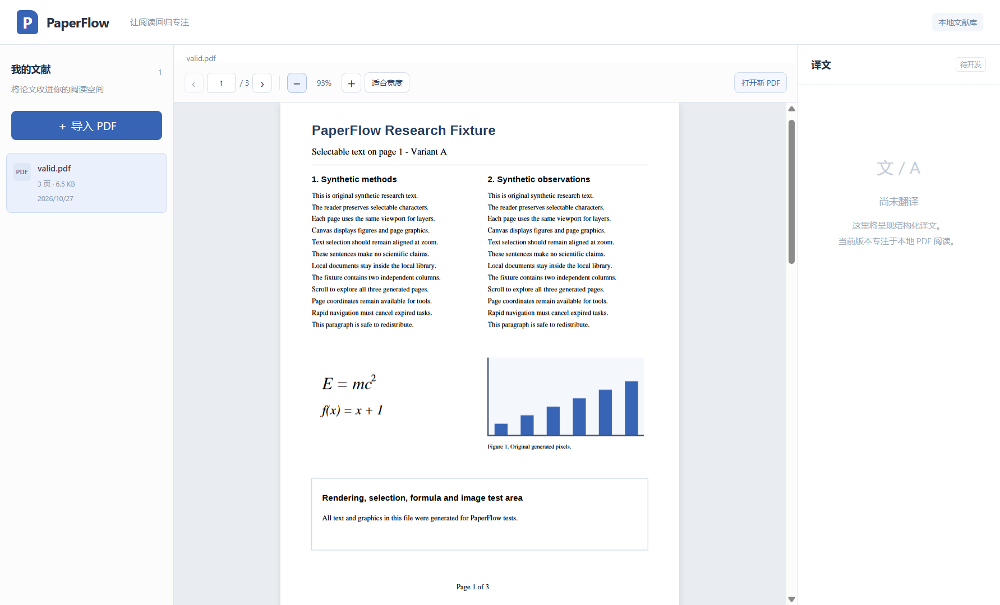

# PaperFlow T01–T03 交付报告
日期：2026-10-27。项目直接创建于 `<repo-root>`，没有额外套一层目录。

核心桌面、导入、真实 PDF 阅读、文字选择复制与阅读状态均已通过运行测试。Windows 安装包是未签名的本地测试产物；NSIS 安装/卸载、真实加密 PDF 样本等仍未验证，不能据此宣称全场景验收完成。

## 1. 实际目录
以下为交付源文件与主要产物；node_modules、缓存及生成资源的内部文件不逐项展开。
```text
<repo-root>\
├─ src/
│  ├─ main/
│  │  ├─ index.ts
│  │  ├─ window.ts
│  │  ├─ ipc/index.ts
│  │  └─ services/
│  │     ├─ app-protocol.ts
│  │     ├─ database.ts
│  │     ├─ document-service.ts
│  │     └─ pdf-validation.ts
│  ├─ preload/
│  │  ├─ index.ts
│  │  └─ validation.ts
│  ├─ renderer/
│  │  ├─ index.html
│  │  ├─ validation.html
│  │  ├─ validation.ts
│  │  ├─ public/pdfjs/       [脚本生成，本地CMaps/字体/WASM/ICC]
│  │  └─ src/
│  │     ├─ App.tsx
│  │     ├─ main.tsx
│  │     ├─ env.d.ts
│  │     ├─ assets/main.css
│  │     └─ features/
│  │        ├─ library/{LibraryPanel.tsx,useLibrary.ts}
│  │        ├─ translation/TranslationPanel.tsx
│  │        └─ reader/
│  │           ├─ PdfViewer.tsx
│  │           ├─ PdfPage.tsx
│  │           ├─ ReaderToolbar.tsx
│  │           ├─ pdf-engine.ts
│  │           ├─ pdf-geometry.ts
│  │           ├─ useReaderPersistence.ts
│  │           ├─ reader-state-writer.ts
│  │           └─ {reader,page,toolbar}.css
│  └─ shared/{contracts.ts,schemas.ts}
├─ tests/
│  ├─ unit/{library,schemas,reader-state-writer}.test.ts
│  ├─ e2e/{bootstrap,library,reader,security}.spec.ts
│  ├─ e2e/helpers.ts
│  └─ fixtures/
│     ├─ {valid,corrupt,invalid-header,scanned}.pdf
│     ├─ same-name-a/paper.pdf
│     ├─ same-name-b/paper.pdf
│     └─ README.md
├─ scripts/
│  ├─ generate-fixtures.ts
│  ├─ generate-icon.ts
│  ├─ prepare-pdf-assets.ts
│  ├─ verify-native.ts
│  ├─ dev-smoke.ts
│  └─ capture-preview.ts
├─ docs/
│  ├─ architecture.md
│  ├─ implementation-notes.md
│  ├─ third-party-licenses.md
│  ├─ delivery-report.md
│  ├─ dependency-versions.json
│  ├─ artifacts.json
│  └─ paperflow-reader.png
├─ resources/{icon.png,THIRD-PARTY-NOTICES.txt}
├─ resources/licenses/     [41份原文与manifest]
├─ build/{icon.ico,icon.png}
├─ 项目管理/README.md       [本机状态与备份另行忽略]
├─ out/                    [生产构建]
├─ release/
│  ├─ PaperFlow-0.1.0-win-x64-setup.exe
│  ├─ PaperFlow-0.1.0-win-x64-setup.exe.blockmap
│  └─ win-unpacked/         [完整程序目录，含PaperFlow.exe]
├─ README.md
├─ LICENSE
├─ AGENTS.md
├─ package.json
├─ pnpm-lock.yaml
├─ pnpm-workspace.yaml
├─ electron.vite.config.ts
├─ electron-builder.yml
├─ eslint.config.mjs
├─ playwright.config.ts
├─ vitest.config.ts
├─ tsconfig{,.node,.web,.test}.json
└─ .editorconfig / .gitattributes / .gitignore / .npmrc / 编辑器格式配置
```

## 2. 各阶段功能
| 阶段 | 已实现并验证 |
|---|---|
| T01 | Electron+React+严格TS；1440×900三栏浅色布局；图标；HMR；安全沙盒与业务Preload；app://本地协议；CSP、导航/弹窗/权限拒绝；Windows构建与实际启动 |
| T02 | 系统PDF选择入口；扩展名/实际文件头/100MiB限制；沙盒PDF结构解析；SHA256去重；UUID副本；同名共存；失败清理；SQLite两表与迁移；安全IPC；重启恢复文献 |
| T03 | 实际PDF.js本地Worker；逐页Canvas与官方TextLayer；多页连续滚动、鼠标选字复制、页码导航、50%–300%缩放、适合宽度；高DPI；按需渲染、任务取消和释放；扫描页提示；进度防抖及关闭刷新 |

右侧译文独立容器只显示“尚未翻译”，本阶段没有任何 AI 调用。UI 展示标题和来源时间；原始测试内容均由生成器原创，不含真实论文全文。

## 3. 实际版本
| 主要组件 | 安装版本 |
|---|---|
| Electron / electron-vite / Vite | 44.7.2 / 6.0.0 / 8.3.4 |
| React / React DOM | 19.3.0 / 19.3.0 |
| TypeScript | 5.9.3 |
| PDF.js（pdfjs-dist） | 6.4.299 |
| better-sqlite3 / 实际SQLite | 13.0.3 / 3.53.4 |
| Zod | 4.6.7 |
| Tailwind CSS | 4.3.3 |
| Vitest / Playwright | 5.0.5 / 1.64.1 |
| electron-builder / ESLint | 26.15.3 / 10.13.0 |
| Node.js / pnpm（本机） | 24.21.0 / 11.25.0 |

完整直接依赖实际版本见 [dependency-versions.json](dependency-versions.json)，精确依赖图见根目录 pnpm-lock.yaml。shadcn/ui 为可选项，本次简单控件无需引入。

## 4. IPC 与数据库
`window.paperflow` 仅有 importPdf、listDocuments、readPdfBytes、updatePageCount、getReaderState、saveReaderState 六个业务方法。主进程逐次核对受信窗口、主frame、精确URL及Zod参数。PDF字节只按合法入库UUID读取，前端没有绝对路径、原始IPC或系统命令接口。

SQLite位于userData/paperflow.sqlite，文献副本为userData/library/<UUID>.pdf。documents包含任务书规定的全部字段和SHA256唯一约束；reader_state保存页码、倍率及时间。固定迁移PRAGMA user_version=1，SQL值全部参数绑定，WAL与外键启用。阅读状态450ms防抖、串行写入，切换/关闭主动刷新，will-quit关闭数据库。详细字段和导入一致性见 [architecture.md](architecture.md)。

## 5. 实际测试与构建
| 检查 | 最终结果 |
|---|---|
| pnpm dev + HMR脚本 | 通过，真实窗口与热更新；完整工程复验通过 |
| pnpm typecheck / pnpm lint | 通过 |
| pnpm test | **21/21通过**，3个测试文件 |
| pnpm test:e2e（源码生产构建） | **5/5通过** |
| pnpm test:e2e（最终Windows包） | **5/5通过** |
| 补充真实鼠标滚轮连续阅读用例 | 源码和最终包各1/1通过，译文滚动状态独立 |
| pnpm build / pnpm pack:win / pnpm dist:win | 通过 |
| pnpm fixtures / pnpm rebuild:electron | 通过 |
| 最终包与当前构建比对 | **209文件逐字节一致** |
| 上游原文SHA256 | **41份一致** |
| 生产依赖检查 | Worker存在，无QuickJS资源，无多余Node Canvas原生包 |

原生文件框返回值注入仅用于Playwright选文件，后续导入、解析、哈希、SQLite、Canvas及TextLayer均真实运行。文字测试实际鼠标拖选，并用Ctrl+C和系统剪贴板核定复制为文本。失败历史、环境权限错误及修复后的重测见 [implementation-notes.md](implementation-notes.md)，未将早期失败删除或冒充通过。

## 6. 验收状态
| 状态 | 项目 |
|---|---|
| 已通过 | 启动/HMR/严格类型/生产构建；Node不可用、IPC来源/参数/资源白名单/外网拒绝；合法导入、去重、同名共存、损坏拒绝、重启读取；Canvas、真实Worker、TextLayer、鼠标选择和复制、缩放图层对齐、连续阅读/翻页、8轮快速缩放切换、扫描页、关闭恢复；本地Windows程序启动 |
| 最终未通过 | 无已知阻断核心功能的失败；开发中出现过的失败及修复已单独记录 |
| 未完整验证 | 原生文件框完整选文件操作（已打开但工具无法可靠聚焦）；NSIS安装/卸载及其他机器；真实加密PDF；独占文件锁、磁盘满、断电；极长PDF、多种DPI硬件、复杂旋转/CropBox/UserUnit坐标组合 |
| 已确认的交付限制 | 安装包未签名；正式公开分发前仍需落实Liberation字体对应源码及整体源码/许可证义务 |

## 7. Windows 产物
- 安装包：`<repo-root>\release\PaperFlow-0.1.0-win-x64-setup.exe`
- 大小：**122,992,594字节，约117.29MiB**
- SHA256：`c2a582f7b40ca350d7e4570ab1a7009b6ed4cd2484045f691fb9b0282d64109e`
- Authenticode：**NotSigned**
- 可直接启动的完整程序目录：`<repo-root>\release\win-unpacked\`，入口PaperFlow.exe。

[完整产物校验数据](artifacts.json)。没有签名证书，没有自动上传GitHub Release或远程部署。解包程序需保留同目录资源。

## 8. 仍需处理的事项
1. NSIS安装/卸载、其他Windows机器与加密PDF等尚未验收，不能标为通过。
2. 长文档仅Canvas懒渲染，保留所有页面占位DOM；极端页数性能待后续测量。
3. 导入逐页解析有20秒时限，复杂合法文件可能被拒绝；不是全项PDF标准验证器。
4. 普通导入失败会清理，断电在文件重命名/数据库提交间仍可能产生孤立副本；可在后续加启动恢复。
5. 关闭等待最多2秒，强制杀进程或磁盘故障不保证最近一次进度。
6. 测试包未签名。字体源码提供与正式分发许可事项见 [第三方清单](third-party-licenses.md)；并未预先认可未来翻译引擎的分发组合。
7. Vitest当前仍提示未来Vite原生配置加载的模块格式警告，不阻断本次运行。

## 9. T04–T08 可复用接口
| 接口 | 复用内容 |
|---|---|
| PdfViewerProps.onPageData / PdfPageProps.onPageData | 页面资源借用回调，离屏或过期以null撤销 |
| PdfPageData | geometry、原始textContent、官方TextLayer、页面element |
| PageTextContent | PDF.js文字items、样式和transform，保持原始粒度，不提前假定一句一项 |
| PageGeometry | 页码、PageViewport、outputScale；CSS与物理像素明确分开 |
| pdfPointToViewport / viewportPointToPdf | PDF点与显示点双向转换 |
| pdfRectToViewport / viewportRectToPdf | 四角映射得到显示/PDF矩形 |
| clientPointToPdf / selectionToPdfRects | 鼠标与真实选区映射到分页PDF坐标 |

未来高亮层置于单页pdf-page-surface，与Canvas/TextLayer使用同一viewport；长期保存未缩放PDF坐标。句子切分、多栏阅读顺序、原译文句子ID和对齐关系属于下一阶段，不提前用图片封装或丢失文字坐标。

真实阅读画面（最终Windows程序，原创PDF）：

